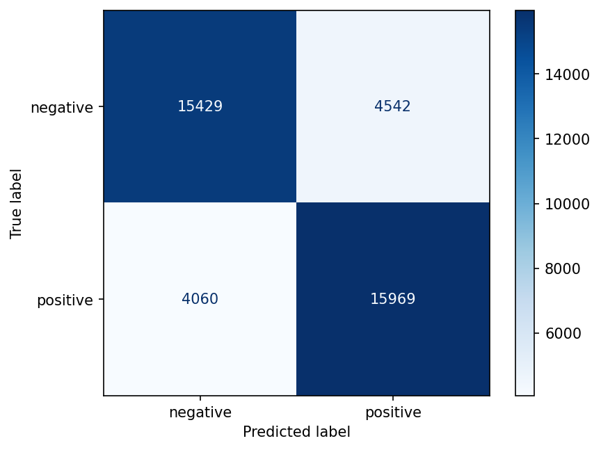

# 🐦 Sentiment Analysis on Twitter Data


A Natural Language Processing tool that classifies tweets as **positive**, **negative** or **neutral**. It uses an NLTK text-cleaning pipeline, TF-IDF features and a Logistic Regression classifier, trained on 200,000 real tweets from the Kaggle Sentiment140 dataset.

Built as part of my AI internship project work at Codec Technologies.

---

## ✨ Highlights

- **End-to-end NLP pipeline**: raw tweet → cleaning → features → prediction
- **Tweet-aware preprocessing** with NLTK: URLs, `RT`, @mentions and hashtags handled; repeated letters ("soooo") reduced; negations (*not, never, no*) deliberately kept because they flip sentiment
- **Unigram + bigram TF-IDF**, so phrases like "not good" are captured
- **Three-way output** (positive / negative / neutral) using a confidence threshold
- **Command-line predictor**: classify any sentence in one line

## 📊 Results

Evaluated on a held-out test set of 40,000 tweets (80/20 stratified split of a 200,000-tweet random sample, seed 42).

| Class | Precision | Recall | F1-score |
|---|---|---|---|
| Negative | 0.79 | 0.77 | 0.78 |
| Positive | 0.78 | 0.80 | 0.79 |
| **Overall accuracy** | | | **0.78** |

The confusion matrix is saved as `confusion_matrix.png`.



### Example predictions

```text
$ python predict.py "I love this!" "This is terrible"
positive  (0.99)  I love this!
negative  (0.94)  This is terrible
```

> **Why ~78%?** Sentiment140 labels were generated automatically from emoticons (":)" / ":("), not by humans, so the labels themselves are noisy. This is a known ceiling for classical models on this dataset.

## 🧠 How it works

```
Raw tweet
   │
   ▼
Cleaning (NLTK)  ── remove URLs / RT / @handles, lowercase, tokenize,
   │                 drop stopwords (keep negations), Porter stemming
   ▼
TF-IDF (1-2 grams, sublinear tf)
   │
   ▼
Logistic Regression  ──►  P(positive)
   │
   ▼
P ≥ 0.60 → positive │ P ≤ 0.40 → negative │ otherwise → neutral
```

**About the neutral class:** the dataset only contains positive and negative tweets, so "neutral" is a *confidence-based* label: the model returns neutral when it is unsure (P(positive) between 0.40 and 0.60). It is a practical heuristic, not a separately trained class.

## 📁 Project structure

```
sentiment-analysis-twitter/
├── src/
│   ├── preprocess.py      # tweet cleaning with NLTK
│   ├── train_kaggle.py    # trains on Sentiment140 (Kaggle)  ← main script
│   ├── train.py           # quick demo: trains on NLTK twitter_samples (auto-download)
│   └── predict.py         # command-line prediction (positive / negative / neutral)
├── models/                # trained model is saved here (git-ignored)
├── data/                  # put the Kaggle CSV here (git-ignored)
├── confusion_matrix.png
├── requirements.txt
└── README.md
```

## 🚀 Getting started

### 1. Install

```bash
git clone https://github.com/<your-username>/sentiment-analysis-twitter.git
cd sentiment-analysis-twitter
pip install -r requirements.txt
```

### 2. Get the dataset

Download **Sentiment140** from Kaggle: <https://www.kaggle.com/datasets/kazanova/sentiment140>

Unzip it and place `training.1600000.processed.noemoticon.csv` inside the `data/` folder.

Or with the Kaggle CLI:

```bash
kaggle datasets download -d kazanova/sentiment140 -p data --unzip
```

### 3. Train

```bash
cd src
python train_kaggle.py
```

This prints the classification report, saves `confusion_matrix.png` and stores the model in `models/sentiment.joblib`.

*(No Kaggle account? `python train.py` trains a smaller version on NLTK's built-in `twitter_samples`, which downloads automatically.)*

### 4. Predict

```bash
python predict.py "I love this!" "This is terrible" "The meeting is at 3 pm"
```

## ⚠️ Limitations

- Neutral detection is a heuristic; plain factual sentences may still be pushed to positive or negative.
- Sarcasm, slang and emojis are not handled.
- Trained on a 200k-tweet sample from 2009, so newer vocabulary may be missed.

## 🔮 Future work

- Train on a human-labelled 3-class dataset to get a real neutral class
- Fine-tune a transformer such as BERTweet or DistilBERT
- Add emoji handling and a Streamlit web demo

## 📚 Dataset credit

Go, A., Bhayani, R., Huang, L. (2009). *Twitter Sentiment Classification using Distant Supervision.* Stanford University. Dataset on Kaggle by KazAnova.

## 🛠️ Tech stack

Python · NLTK · scikit-learn · pandas · joblib · matplotlib